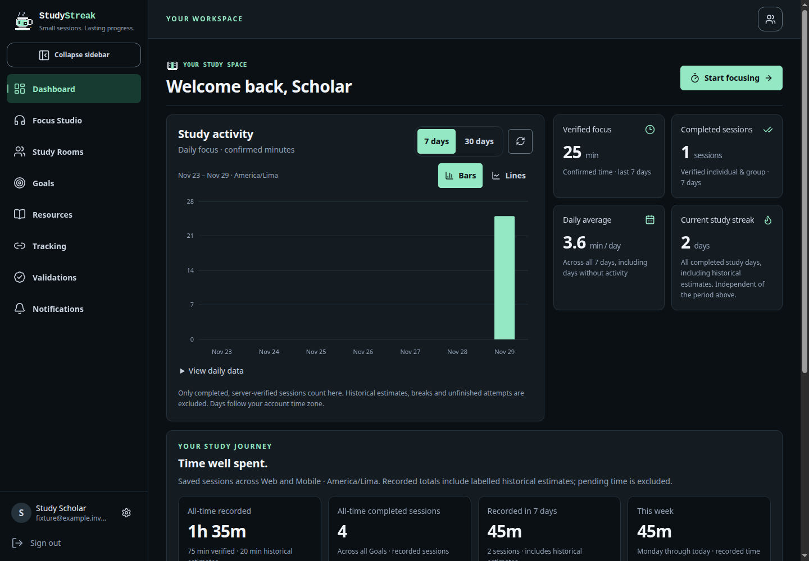
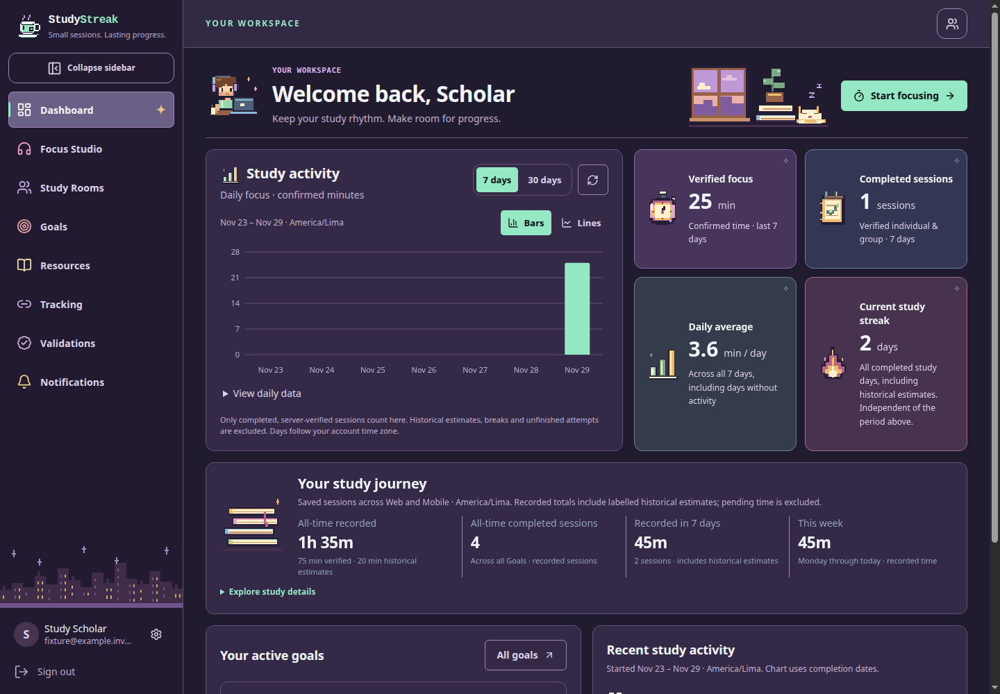
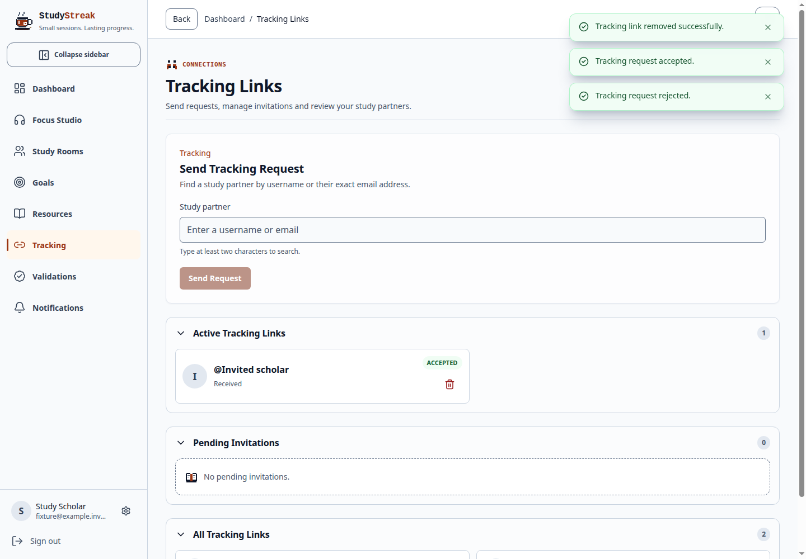
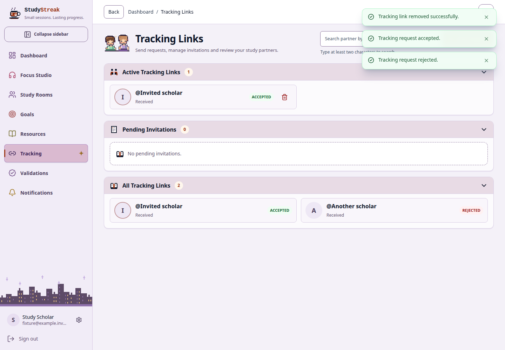
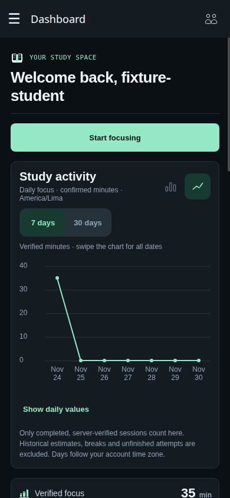
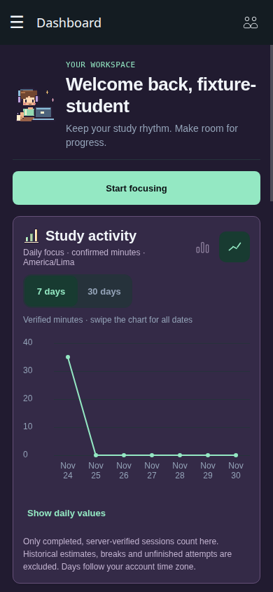
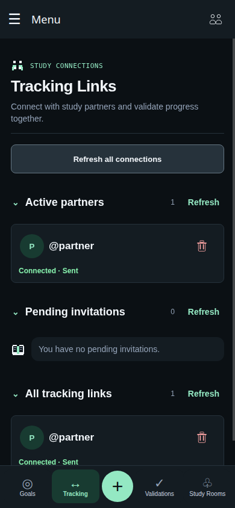
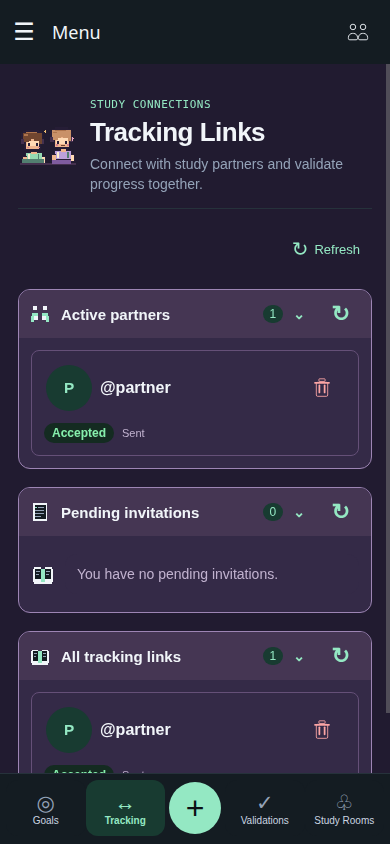

# Etapa 7.4 — Rediseño visual Retro Pixel Academia

Rama `feat/ui-ux-web-mobile`. Base `d347888` (interacciones de 7.4a). Se revisaron AGENTS.md, Git, los componentes y el informe de 7.4a. El trabajo comenzó únicamente con los **16 elementos ajenos** originales, sin staging ni implementación pendiente de esta entrega. Permanecen intactos y fuera del commit.

## Dirección y diferencias visibles

Se tomó la propuesta aprobada como referencia de composición: bienvenida ilustrada, espacio académico nocturno de matiz lavanda, métricas con iconografía propia, franja de libros y navegación con banda activa. Los recursos son originales; no se copiaron los personajes o la imagen de referencia dentro de la aplicación.

| Área | Implementación |
| --- | --- |
| Dashboard Web | Bienvenida con estudiante, portátil y auriculares; pequeña ventana con planta, libros y gato en escritorio. El CTA conserva su destino. Gráfico protagonista más compacto, controles 7/30 y Bars/Lines; cuatro métricas a la derecha con cronómetro, libreta, crecimiento y llama pixelados, cada una con una superficie secundaria suave. En anchuras pequeñas las métricas se apilan debajo. |
| Study Journey | Cabecera con libros, resumen horizontal de las cuatro métricas registradas y separadores finos. Se eliminan las cuatro tarjetas interiores independientes de este resumen. Los detalles Activity/Goals/Together/History siguen disponibles y mantienen sus datos y paginación. |
| Tracking Web | Cabecera social ilustrada y búsqueda junto a Send Request; desaparece el gran bloque de formulario separado. Se conservan etiqueta accesible, validaciones, debounce, resultados, selección y mensajes. Bandas de sección, contadores, chevrons a la derecha, filas compactas, avatares de 48 px y estados pequeños. Hover/foco modifica borde y eleva la fila 2 px; se respeta Reduce Motion. |
| Sidebar Web | Misma taza y navegación de 7.4a, con banda activa lavanda/acento, pequeña estrella decorativa, iconos de colores secundarios y paisaje académico inferior estático. Cuenta, Settings y Sign out mantienen su espacio. Contraer, tooltips, contadores y animaciones anteriores siguen funcionando; el paisaje se oculta en ventanas bajas y se recorta de forma decorativa al contraer. |
| Dashboard Mobile | Bienvenida ilustrada compacta; gráfico y filtros nativos existentes. Cuatro métricas táctiles/legibles apiladas, con sus ilustraciones y tonos. Journey se adapta a dos columnas sin tarjetas interiores gruesas; los complementos de Dashboard consumen la misma superficie local. |
| Tracking Mobile | Cabecera social, paneles plegables con icono, contador y chevron, refresco compacto, identidades destacadas y badges Accepted. Se mantienen el drawer, pestañas y `+`: la búsqueda continúa en su formulario modal nativo, con arte y colores coherentes. La identidad tiene respuesta pressed de opacidad/escala; la escala se omite con Reduce Motion. |

La composición cambia de forma visible, además de los colores: arte identificativo, jerarquía de las métricas, altura del gráfico, resumen Journey, ubicación del buscador, cabeceras de grupos y pie de navegación. No se añaden XP, puntos, niveles, porcentajes o estados sociales.

## Temas y alcance

La atmósfera lavanda utiliza tokens **locales** de Dashboard/Tracking y del sidebar. Dark/Light/System y Mint/Blue/Purple/Orange siguen determinando el acento, botones, gráficos, selección y foco mediante el proveedor existente. Los tonos secundarios de las métricas y las ilustraciones complementan esas paletas. No se reemplaza ninguna preferencia ni se introduce otro proveedor de apariencia.

Web aplica `retro-shell` sólo a Dashboard y Tracking; el resto de rutas conserva su superficie global. Mobile utiliza `workspacePalette` en esos componentes y una propiedad opcional de fondo de Screen, cuyo valor por defecto sigue igual para las demás pantallas. AcademicHeading admite arte opcional sin cambiar el comportamiento por defecto de los otros módulos.

Se reutilizan AcademicHeading, AcademicPanel, PixelGlyph, StudyBrand, los componentes de métricas y todos los controles/datos existentes. El sidebar no se transforma en una colección de tarjetas. No hay degradados intensos, brillos, fondos fullscreen nuevos ni animaciones decorativas continuas.

## Fuente gráfica original y rendimiento

Nueve ilustraciones: `scholar`, `companions`, `books`, `nook`, `stopwatch`, `notebook`, `growth`, `flame` y `skyline`. Se autoran en retículas de rectángulos enteros en `scripts/create-academic-sprites.mjs`, con fuente canónica `assets/academic/sprites.json`.

`generate-academic.mjs` mantiene los glifos anteriores intactos y genera:

- SVG locales para Web con bordes nítidos y metadatos de proporción.
- PNG transparentes a resolución 4× para Expo Go, importados estáticamente. El conjunto PNG suma aproximadamente 11 KiB comprimidos, sin peticiones a un proveedor externo ni una View nativa por píxel.
- AcademicSprite adapta tamaño/proporción y oculta el arte al lector de pantalla. Las imágenes decorativas no capturan pulsaciones ni sustituyen los avatares de usuario.

No se instalan dependencias. Las ilustraciones son estáticas y no añaden timers, sensores, polling ni trabajo ambiental en background. No se afirma haber medido FPS o memoria en un teléfono real.

## Integridad funcional

- Se conserva la consulta compartida de Dashboard a `/api/focus-sessions/stats`, `verifiedPeriod`, controles, cifras, unidades y aclaraciones históricas. No se cambian cálculos ni se deriva tiempo del historial paginado. Focus Studio y sus servicios no se modifican.
- Tracking conserva las tres listas/paginadores, estado de expansión independiente sin nuevas consultas al plegar, envío, aceptación/rechazo, borrado confirmado y navegación desde avatar/nombre. Send Request permanece deshabilitado hasta seleccionar a una persona. La tarjeta completa no elimina ni navega.
- Avatares protegidos, fallback, autorización, caché/cola, liberación de URLs/archivos y aislamiento entre cuentas mantienen su implementación. No se añade presencia ni se usa un indicador verde ficticio.
- No se modifican autenticación, JWT, refresh, Pomodoro, UUID, outbox, reloj, ledger, permisos o contratos REST. Tampoco Goals, Validations, Study Rooms, Resources, Login/Register, backend, PostgreSQL, Docker, AWS o archivos privados.

## Comparación visual antes/después

Las capturas anteriores corresponden al código base `d347888`, inspeccionado antes de editar. Las posteriores se generaron en Chrome y React Native Web con mocks. Son fixtures de prueba; no representan la cuenta ni la actividad real del usuario. Las comparaciones principales usan los mismos tamaños y los recorridos equivalentes; la galería adicional de Tracking oscuro muestra una etapa anterior a las mutaciones simuladas.

| Vista | Antes | Después |
| --- | --- | --- |
| Dashboard Web, 1440×1000 |  |  |
| Tracking Web claro, 1440×1000 |  |  |
| Dashboard Mobile, 390×844 |  |  |
| Tracking Mobile, 390×844 |  |  |

Vistas adicionales versionadas: [Tracking oscuro](images/retro-7-4-visual/after-tracking-web.png), [Dashboard claro estrecho](images/retro-7-4-visual/after-dashboard-web-light.png), [sidebar contraído](images/retro-7-4-visual/after-sidebar-collapsed.png) y [Journey Mobile](images/retro-7-4-visual/after-journey-mobile.png).

Se compararon explícitamente composición, densidad, arte y controles. El resultado deja de ser prácticamente igual a 7.4a. En la revisión a 320 px se corrigió el ancho mínimo de una fila Pending que podía quedar recortada por el panel. La prueba nueva comprueba también los límites de las tarjetas, además del overflow del documento.

La galería temporal Web `/tmp/74-visual-{dashboard,tracking-links}-{dark,light}-{ancho}.png` y las galerías Mobile `.expo/73a-dashboard-*` / `.expo/73b-tracking-*` complementan las doce capturas versionadas. Incluyen 320, 390, 768 y 1440 px; Dashboard Mobile conserva además las comprobaciones a 1920 px.

## Pruebas

- ESLint y TypeScript Web/Mobile: aprobados. TypeScript Web forma parte de `npm run build`.
- Build Web: aprobado. Se conserva la advertencia conocida del chunk Study Rooms >500 kB; no se cambia ese módulo.
- Expo export **Web y Android**: aprobados. Sin build nativo ni instalación. Los artefactos de prueba bajo `.expo` usan una URL API de fixture; los `.env` privados se mantienen intactos.
- Web: **22 casos UI distintos aprobados en ejecuciones dirigidas**, en dashboardRendering, trackingPolish, retroWorkspace, workspaceInteractions, academic, studyPartnersRendering y authScenes. Cubren SSR/semántica, gráficos/filtros, consulta compartida, imágenes locales decodificadas, disposición escritorio/móvil, tres modos/cuatro paletas, ausencia de animación con Reduce Motion, aislamiento de estilos por ruta, búsqueda/envío, plegado, identidad/perfil, confirmación/DELETE, ACCEPT/REJECT, sidebar/tooltip/Escape y panel derecho compartido.
- La regresión de authScenes se repitió sola tras un fallo de instrumentación que buscó Login durante el cambio de ruta. Sus **3 casos pasaron**; no se cambió código ni arte de Login/Register.
- Mobile: **7 archivos aprobados**: dashboardRendering, academic, socialRendering, mobileMenuNavigation, mobileAppearanceRendering, appearanceState y focusStudioRendering.
- Recorridos React Native Web **mobileDashboard y mobileSocial aprobados**: chart styles, 7/30, errores/retry/vacío, preferencias de tema, puerta de Menu/Reduce Motion, Back, búsqueda/selección, grupos, imágenes no autorizadas/fallback, perfiles, cancelación y borrado confirmado, revocación, logout y cambio de cuenta. Se ajustó la espera de montaje/foco del modal de prueba antes de enviar Escape, sin alterar la navegación de producción.
- Generadores con `--check`, geometría/proporciones de sprites y `git diff --check`: aprobados.

Las operaciones de escritura usan únicamente mocks. No se prueban escrituras sobre PostgreSQL persistente. No se realiza una auditoría general de módulos fuera de la entrega.

## Verificaciones pendientes en Android

No se operó un dispositivo físico. En Expo Go, con la configuración local habitual: revisar nitidez de sprites a densidad real, fuente grande/TalkBack, foco, SafeArea y teclado; Dark/Light/System y las cuatro paletas; plegar los tres grupos; identidad → perfil → Back; `+` → búsqueda → cancelar; papelera → Keep y, sólo en datos de prueba autorizados, Remove. Revisar respuesta pressed con/sin Reduce Motion y reanudación después de background. No se necesita development build para estos cambios.

## Archivos modificados

- `assets/academic/sprites.json`
- `docs/images/retro-7-4-visual/after-dashboard-mobile.png`
- `docs/images/retro-7-4-visual/after-dashboard-web-light.png`
- `docs/images/retro-7-4-visual/after-dashboard-web.png`
- `docs/images/retro-7-4-visual/after-journey-mobile.png`
- `docs/images/retro-7-4-visual/after-sidebar-collapsed.png`
- `docs/images/retro-7-4-visual/after-tracking-mobile.png`
- `docs/images/retro-7-4-visual/after-tracking-web-light.png`
- `docs/images/retro-7-4-visual/after-tracking-web.png`
- `docs/images/retro-7-4-visual/before-dashboard-mobile.png`
- `docs/images/retro-7-4-visual/before-dashboard-web.png`
- `docs/images/retro-7-4-visual/before-tracking-mobile.png`
- `docs/images/retro-7-4-visual/before-tracking-web.png`
- `docs/retro-pixel-academia-etapa-7-4-visual.md`
- `frontend-mobile/assets/academic/books.png`
- `frontend-mobile/assets/academic/companions.png`
- `frontend-mobile/assets/academic/flame.png`
- `frontend-mobile/assets/academic/growth.png`
- `frontend-mobile/assets/academic/nook.png`
- `frontend-mobile/assets/academic/notebook.png`
- `frontend-mobile/assets/academic/scholar.png`
- `frontend-mobile/assets/academic/skyline.png`
- `frontend-mobile/assets/academic/stopwatch.png`
- `frontend-mobile/src/app/(app)/(main)/(menu)/tracking/index.tsx`
- `frontend-mobile/src/app/(app)/(main)/dashboard.tsx`
- `frontend-mobile/src/components/academic/Academic.tsx`
- `frontend-mobile/src/components/academic/AcademicSprite.tsx`
- `frontend-mobile/src/components/academic/spriteImages.ts`
- `frontend-mobile/src/components/academic/sprites.ts`
- `frontend-mobile/src/components/academic/workspacePalette.ts`
- `frontend-mobile/src/components/dashboard/DashboardActivity.tsx`
- `frontend-mobile/src/components/dashboard/DashboardContext.tsx`
- `frontend-mobile/src/components/focus/FocusInsightsMobile.tsx`
- `frontend-mobile/src/components/tracking/PartnerSearch.tsx`
- `frontend-mobile/src/components/tracking/TrackingLinkCard.tsx`
- `frontend-mobile/src/components/ui/Screen.tsx`
- `frontend-mobile/tests/helpers/academicGallery.mjs`
- `frontend-mobile/tests/mobileDashboard.browser.mjs`
- `frontend-web/package.json`
- `frontend-web/public/academic/books.svg`
- `frontend-web/public/academic/companions.svg`
- `frontend-web/public/academic/flame.svg`
- `frontend-web/public/academic/growth.svg`
- `frontend-web/public/academic/nook.svg`
- `frontend-web/public/academic/notebook.svg`
- `frontend-web/public/academic/scholar.svg`
- `frontend-web/public/academic/skyline.svg`
- `frontend-web/public/academic/stopwatch.svg`
- `frontend-web/src/components/academic/Academic.tsx`
- `frontend-web/src/components/academic/AcademicSprite.tsx`
- `frontend-web/src/components/academic/retro-workspace.css`
- `frontend-web/src/components/academic/sprites.ts`
- `frontend-web/src/components/dashboard/DashboardMetrics.tsx`
- `frontend-web/src/components/dashboard/FocusInsights.tsx`
- `frontend-web/src/components/dashboard/StudyActivityChart.tsx`
- `frontend-web/src/components/layout/AppSidebar.tsx`
- `frontend-web/src/components/layout/sidebar.css`
- `frontend-web/src/components/navigation/AuthenticatedLayout.tsx`
- `frontend-web/src/components/trackingLinks/TrackingGroup.tsx`
- `frontend-web/src/components/trackingLinks/TrackingLinkCard.tsx`
- `frontend-web/src/components/trackingLinks/TrackingLinkForm.tsx`
- `frontend-web/src/pages/Dashboard.tsx`
- `frontend-web/src/pages/TrackingLinks.tsx`
- `frontend-web/tests/retroWorkspace.test.mjs`
- `scripts/create-academic-sprites.mjs`
- `scripts/generate-academic.mjs`

## Registro

Se registra la implementación mediante staging explícito con `feat(ui): redesign dashboard tracking and sidebar retro style`. El hash real se incorpora en un seguimiento sólo documental para evitar amend y una autorreferencia. Los 16 elementos ajenos se mantienen fuera de ambos commits. No hay push, merge, reset, deployment ni inicio de otra etapa.

**Commit de implementación:** `4d13504 feat(ui): redesign dashboard tracking and sidebar retro style` (66 archivos, incluidas las doce capturas comparativas). Tras registrarlo quedan únicamente los 16 elementos preexistentes ajenos y este añadido documental hasta su registro.
